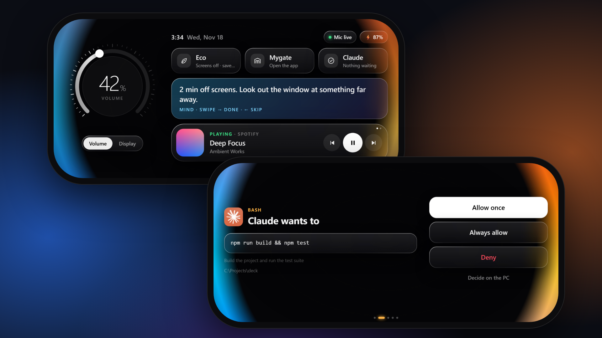
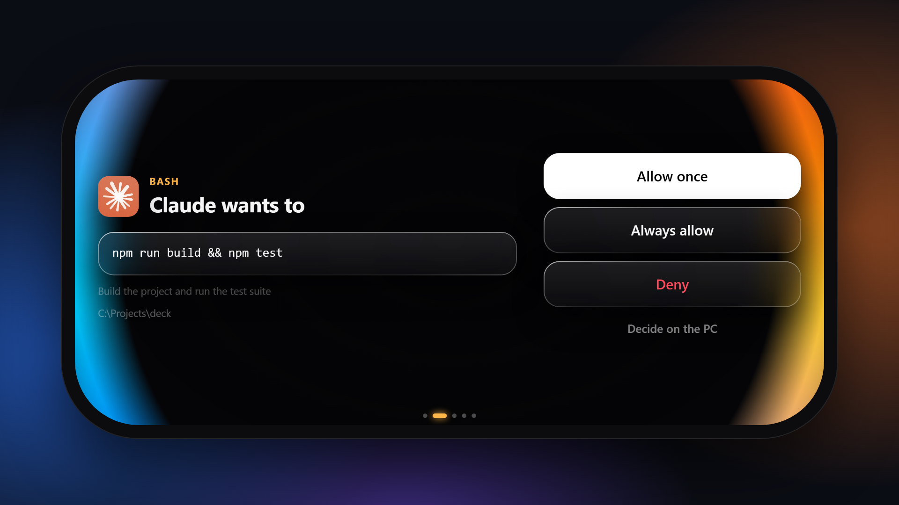
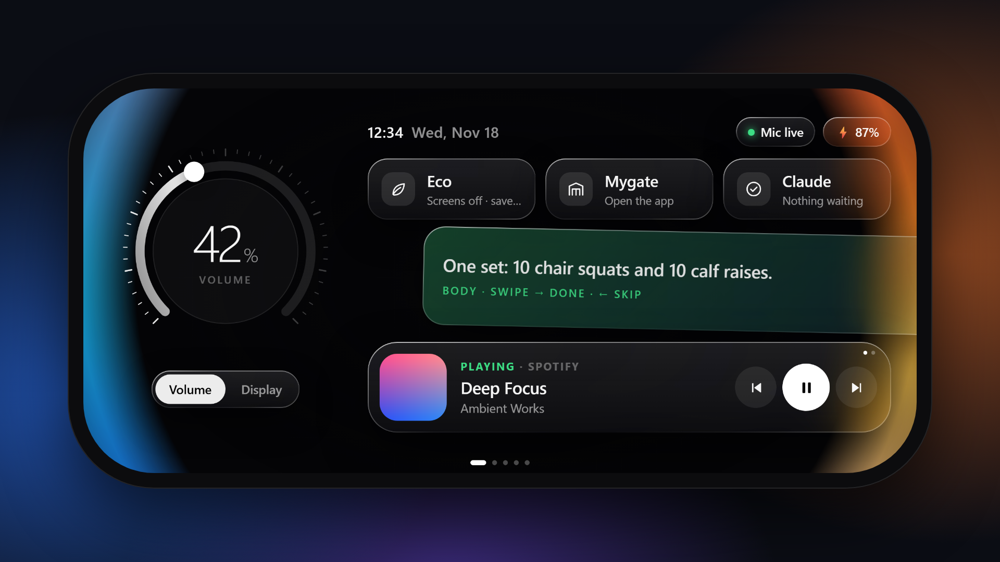

# Control Deck

Turn a spare phone into a control deck for your Windows laptop. The laptop is the first thing it controls; the idea is a small home control panel that grows from there.

The main reason it exists: when Claude Code stops to ask for permission, the request shows up on the phone and you tap **Allow once**, without leaving what you are doing on the laptop. It also does volume, brightness, now playing, your next meeting, a power-saving mode and a set of reminders through the day.



## What it does

- **Claude: approve Claude Code from the phone.** A permission request from Claude Code appears on the phone with the command it wants to run. Allow once, Always allow, Deny, or "Decide on the PC". The Claude tile on the home screen lights up when something is waiting and allows it with one tap.
- **Eco.** Turns off the screens, switches Windows to Best power efficiency, pauses media and mutes the mic. Touch any key or the mouse and everything comes back. It does not lock the laptop.
- **App shortcuts on the phone.** A tile can open an app on the phone itself. The default one opens Mygate (an Indian gated-community app); point `url` in `config.json` at any app link you use.
- **Away** (optional tile). Pauses media, mutes the mic and locks the laptop. Tap again when you are back.
- **Volume and brightness dial**, mic mute, battery.
- **Now playing** with album art and play, pause, next and previous.
- **Next meeting** from your calendar, with a Join button.
- **Reminders and quotes.** A card shows the reminder that is due now: swipe right for done, left to skip it for today. When nothing is due it shows a quote. Both lists are at the top of the script in `static/index.html`; edit them to your own day.
- **Tiles you can change from the phone** (screenshot, snip, lock, show desktop, focus timer, open a WhatsApp chat and more).



## What you need

- A Windows 10 or 11 laptop with Python 3.10 or newer
- Any phone or tablet with a browser, on the same Wi-Fi as the laptop

## Set up

1. Download or clone this repository.
2. Install the optional packages (each one only switches on a feature):
   ```
   py -m pip install -r requirements.txt
   ```
3. Start the deck:
   ```
   py server.py
   ```
   The first run creates `config.json` with a new 6-digit PIN, and prints the address to open, for example `http://192.168.x.x:8765`, and the PIN.
4. When Windows asks whether Python may use the network, allow it. If your Wi-Fi is set as a Public network, allow Public as well, or the phone will not reach the laptop.
5. On the phone, open the printed address and enter the PIN.
6. Add it to the home screen so it opens full screen: in Safari, Share > Add to Home Screen; in Chrome, menu > Add to Home screen. Use the phone sideways.

### Keep it running

Double-click `deck_run.pyw` instead of running `server.py`. It starts the deck with no window and restarts it if it ever stops. To start it with Windows, put a shortcut to `deck_run.pyw` in the Startup folder (Win+R, `shell:startup`).

### Connect Claude Code

```
py install_hook.py
```

This adds a `PermissionRequest` hook to `%USERPROFILE%\.claude\settings.json` (it backs the file up first). Restart Claude Code. Requests go to the phone only if the deck has been open on it in the last 15 seconds; otherwise Claude asks on the laptop as usual. If you do not answer within 45 seconds, the question goes back to the laptop.

To undo: `py install_hook.py --remove`

### Show your next meeting

In Google Calendar, open Settings > your calendar > "Secret address in iCal format", copy it, and paste it into `calendar_ics` in `config.json`. Restart the deck. Other calendars that give an `.ics` link work too.

## Make it yours

- **Reminders and quotes:** `static/index.html`, look for `NUDGES` and `QUOTES`. Each reminder is `[from, to, kind, text, days, fixed]`; the comment above the list explains each field.
- **Tiles:** long-press a tile on the phone to change the set, or edit `actions` in `config.json`.



## Security

- The phone needs the PIN for every request. After repeated wrong PINs the deck refuses for a while.
- It listens on your local network only. Do not forward its port to the internet.
- `config.json` holds your PIN, the hook secret and any calendar link. It is in `.gitignore`; keep it out of any repository.
- The Claude Code hook is accepted only from the laptop itself (127.0.0.1) and only with the secret in `config.json`.
- The phone can only trigger the actions defined in the deck. It cannot send arbitrary commands.

## Licence

MIT. See [LICENSE](LICENSE).
